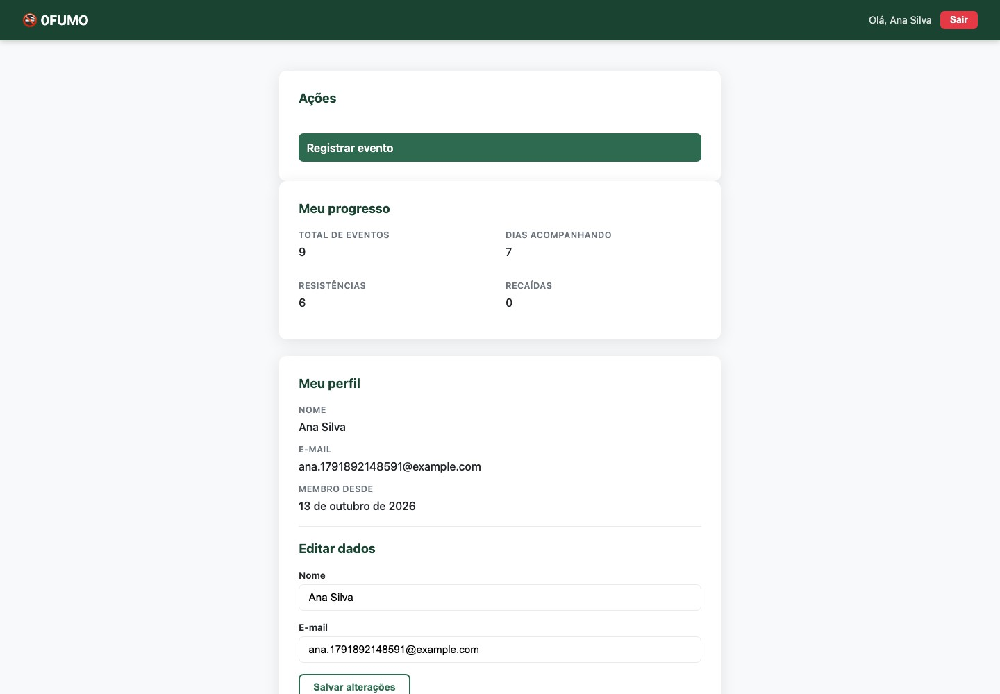
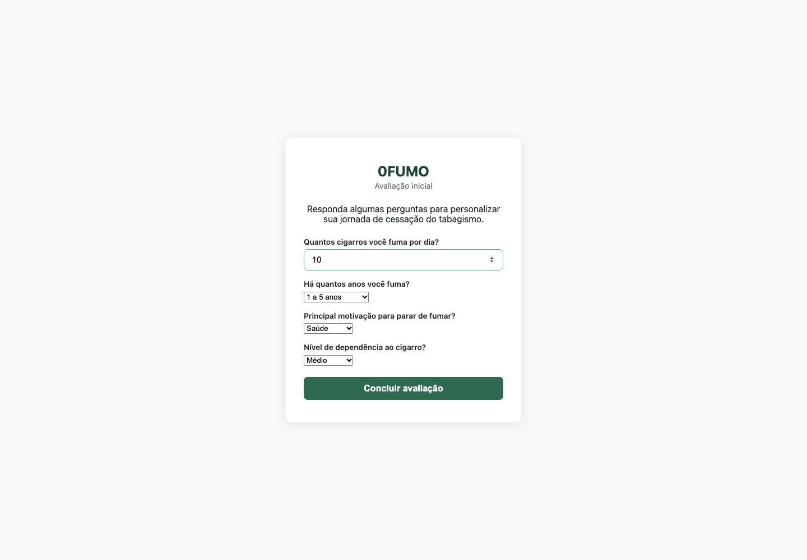
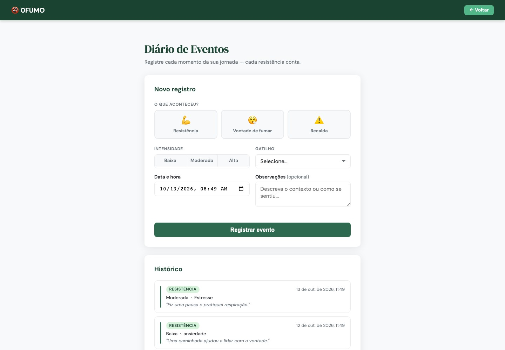
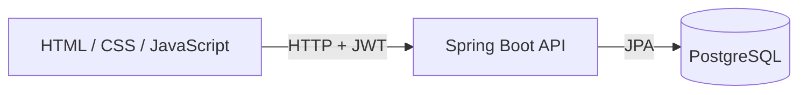

# 0FUMO — Smoking cessation support

A web application for recording cravings, tracking daily progress and finding
relaxation resources while working toward quitting smoking.

**Status:** Academic project · Programming Language 1, IFSP.

[](https://github.com/ErickHTF/0FUMO/actions/workflows/ci.yml)

[Run locally](#run-locally) · [Development guide](DEPLOY.md) ·
[Architecture](docs/architecture.md) · [API reference](backend/README.md#endpoints)



| Initial assessment                                                  | Event diary                                                                 |
| ------------------------------------------------------------------- | --------------------------------------------------------------------------- |
|  |  |

_The interface is in Brazilian Portuguese. Screenshots use synthetic data._

## Overview

0FUMO brings assessment, event logging and progress tracking into one application.
The project applies requirements analysis, modeling and software development to
a smoking cessation support workflow.

- Complete an initial assessment of smoking habits and motivation.
- Record cravings, resisted urges and smoking events with context and intensity.
- Review progress statistics and an event history.
- Find relaxation resources related to recorded triggers.

## Stack

| Layer             | Technologies                                         |
| ----------------- | ---------------------------------------------------- |
| Frontend          | HTML, CSS, JavaScript                                |
| Backend           | Java 21, Spring Boot 4, Spring Security, JWT         |
| Database          | PostgreSQL, Spring Data JPA                          |
| Local environment | Docker Compose, Nginx                                |
| Verification      | JUnit, Spring Boot integration tests, GitHub Actions |

## Run locally

Install **Git** and **Docker with Docker Compose**.

```bash
git clone https://github.com/ErickHTF/0FUMO.git
cd 0FUMO
docker compose --profile app up -d --build
```

Open [localhost:3000](http://localhost:3000), create an account, and complete the
initial assessment. The API runs at [localhost:8080/api](http://localhost:8080/api).

For running Java and the frontend outside containers, follow the
[development guide](DEPLOY.md).

## Verification

With **Java 21** installed, start the local database and run the backend tests:

```bash
docker compose up -d
cd backend
./mvnw test
```

Integration tests exercise registration, assessment, progress tracking, event
logging and resource suggestions. They use the local PostgreSQL database;
run them against a development database.

## Architecture



The browser calls the API with a bearer token. Spring Security protects user
routes, and assessment completion gates progress, events and relaxation
resources. Controllers delegate to services and repositories.

See the [architecture guide](docs/architecture.md) for the source layout and
[academic documentation](docs/README.md) for requirements and models.

## Documentation

| Guide                                         | Contents                                            |
| --------------------------------------------- | --------------------------------------------------- |
| [Development and local deployment](DEPLOY.md) | Prerequisites, startup, ports and shutdown          |
| [Backend reference](backend/README.md)        | API routes, authentication, errors and tests        |
| [Frontend guide](frontend/README.md)          | Browser interface and local serving                 |
| [Architecture](docs/architecture.md)          | Repository layout and design diagrams               |
| [Academic documentation](docs/README.md)      | Requirements, analysis, testing and project records |

## Project context

Developed for the Programming Language 1 course at IFSP. Course documents and
the interface are in Portuguese; this README provides an English project overview.

No license is currently included in this repository.
